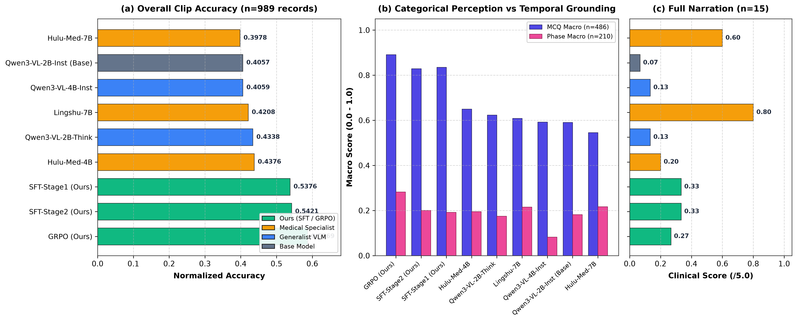
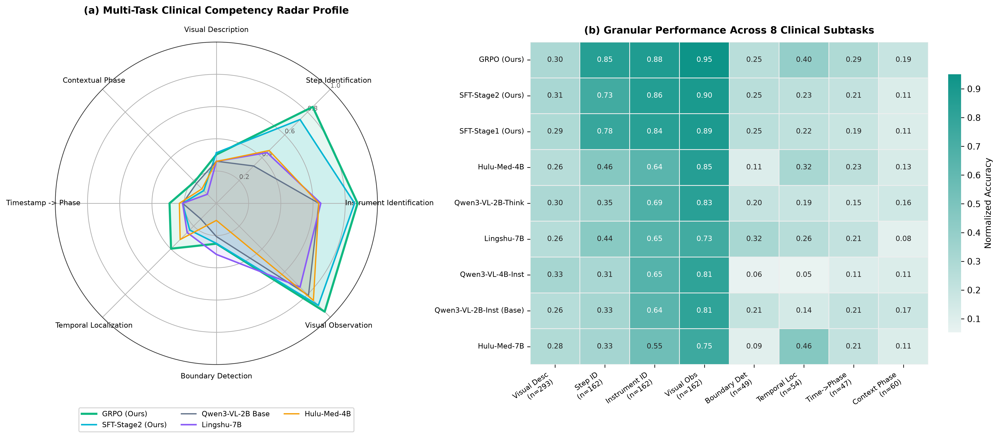

# Stage 3: Surgical VLM Evaluation Framework

[](https://huggingface.co/datasets/shahedm2001/cataract_surgery_vlm_eval)
[](https://huggingface.co/shahedm2001/qwen3-vl-2b-cataract-sft-stage2)
[](https://huggingface.co/shahedm2001/qwen3-vl-2b-cataract-grpo)

A standardized evaluation and benchmarking framework for evaluating Vision-Language Models (VLMs) on fine-grained cataract surgery video understanding tasks. This suite generates model inferences for structured surgical tasks and performs dual evaluation combining deterministic metrics and LLM-as-a-judge protocols.

---

> [!NOTE]
> **Evaluation Dataset on Hugging Face:** The evaluation dataset (1,004 records and 518 videos) is hosted on Hugging Face at [`shahedm2001/cataract_surgery_vlm_eval`](https://huggingface.co/datasets/shahedm2001/cataract_surgery_vlm_eval). You can download and unpack it automatically via `python flatten_dataset.py --hf-repo shahedm2001/cataract_surgery_vlm_eval --output-dir ./evaluation_dataset`.

---

## Overview

This project evaluates how well VLMs understand cataract surgery videos across two granularities:

- **Clip-level**: 989 short surgical video segments covering open-ended visual descriptions (293), multiple-choice surgical questions (486 MCQ: step / instrument / visual cue), and four phase-understanding tasks (210: boundary detection, temporal localization, timestamp→phase, contextual phase recognition).
- **Full-video level**: 15 complete surgery recordings requiring comprehensive procedural narration.

Each record embeds its full task instruction — including the strict JSON `{"explanation", "answer"}` output contract — so the pipeline passes questions through as-is and expects **one response per record** (no CoT/direct variants).

Currently supported model families:
- [HuluMed](https://huggingface.co/ZJU-AI4H/Hulu-Med-4B) (ZJU-AI4H)
- [Qwen3-VL](https://huggingface.co/Qwen/Qwen3-VL-2B-Instruct) (Alibaba)
- [Lingshu-7B](https://huggingface.co/lingshu-medical-mllm/Lingshu-7B) (Qwen2.5-VL based medical MLLM)

---

## Dataset

The evaluation set is the flat `evaluation_dataset/` folder: **1004 one-line JSONL records** + **518 prefixed .mp4 videos** (Test split only, ~3.45 GB). No subfolders — every `video` field is a relative filename in the same folder.

| Task category | Question types | Records | Scoring |
|---|---|---|---|
| **Visual description** | `visual_description` | 293 | LLM judge 0–5 (/5) |
| **MCQ** (YouTube) | `step_identification`, `instrument_identification`, `visual_observation` | 486 | Deterministic exact letter match (0/1) |
| **Phase understanding** | `boundary_detection` (49), `temporal_localization` (54), `timestamp_to_phase` (47), `contextual_phase_recognition` (60) | 210 | Deterministic: `exp(-|Δt|/1.5)`, interval IoU, phase-id exact match + format bonus |
| **Narration** (full video) | `narration` | 15 | LLM judge 5 dimensions 0–5 (/5) |

### Deterministic rewards

- **MCQ and phase identification**: `R_task = 1` if normalized predicted answer == gold (`A`–`D` or `P01`–`P13`), else 0.
- **Boundary detection** (τ = 1.5 s): `R_task = exp(-|t_pred - t_gt| / 1.5)`.
- **Temporal localization**: `R_task = IoU([s_pred,e_pred], [s_gt,e_gt])`.
- **Format bonus (phase tasks only)**: `R_fmt = 1` if strict JSON with exactly `{explanation, answer}` else 0; `R_total = R_task + 0.05 * R_fmt` (max 1.05).
- Answers are parsed from the JSON `answer` key; regex / LLM-extractor fallbacks are applied for malformed outputs (format bonus withheld).

### LLM-judge rewards

- **Visual description**: single integer 0–5 against the reference description (actions, instruments, anatomy, factuality). Normalized score = score / 5.
- **Narration**: five integer 0–5 dimensions (`step_coverage`, `chronological_accuracy`, `visual_technical_accuracy`, `narrative_flow`, `overall_score`). Normalized = overall / 5.

See `evaluation_dataset/README.md` for the full dataset card (schemas, metadata whitelist, naming, usage).

---

## Benchmark Results & Model Performance Visualizations

We benchmarked 9 distinct VLM configurations across 989 clip-level multi-modal tasks and 15 full-video surgical narration procedures. The evaluation contrasts our domain-adapted models against generalist foundations and leading medical specialist VLMs.

### 📊 Overall Benchmark Performance



*Figure 1: Comprehensive benchmark comparison across models. **(a)** Overall clip-level accuracy ($n=989$), highlighting Qwen3-VL-2B-Cataract-GRPO achieving state-of-the-art (**0.5869**). **(b)** Categorical surgical perception (MCQ Macro, $n=486$) versus temporal phase grounding (Phase Macro, $n=210$). **(c)** Full-video procedural narration clinical scores on uncut surgeries ($n=15$).*

---

### 🎯 Clinical Competency Radar & Granular Subtask Breakdown



*Figure 2: Fine-grained clinical subtask performance. **(a)** 8-axis competency radar profile contrasting our GRPO model, curriculum SFT Stage 2, base Qwen3-VL-2B-Instruct, and medical specialist baselines (Lingshu-7B, Hulu-Med-4B). **(b)** Granular performance matrix (heatmap) across all 9 models and 8 clinical subtasks.*

---

### Benchmark Summary Table

| Model Architecture | Parameters | Paradigm / Focus | Overall Clip Acc ($n=989$) | MCQ Macro ($n=486$) | Phase Macro ($n=210$) | Visual Desc ($n=293$) | Narration (/5.0) ($n=15$) |
|:---|:---:|:---:|:---:|:---:|:---:|:---:|:---:|
| **Qwen3-VL-2B-Cataract-GRPO** | 2B | Domain RL (Ours) | **0.5869** | **0.8909** | **0.2825** | 0.3024 | 0.2667 |
| **Qwen3-VL-2B-Cataract-SFT-Stage2** | 2B | Curriculum SFT (Ours) | 0.5421 | 0.8292 | 0.2010 | 0.3133 | 0.3333 |
| **Qwen3-VL-2B-Cataract-SFT** | 2B | Foundation SFT (Ours) | 0.5376 | 0.8354 | 0.1925 | 0.2935 | 0.3333 |
| **Hulu-Med-4B** | 4B | Medical Specialist | 0.4376 | 0.6502 | 0.1953 | 0.2594 | 0.2000 |
| **Qwen3-VL-2B-Thinking** | 2B | Generalist Reasoning | 0.4338 | 0.6235 | 0.1754 | 0.3044 | 0.1333 |
| **Lingshu-7B** | 7B | Medical Specialist | 0.4208 | 0.6090 | 0.2157 | 0.2601 | **0.8000** |
| **Qwen3-VL-4B-Instruct** | 4B | Generalist Instruct | 0.4059 | 0.5926 | 0.0825 | **0.3276** | 0.1333 |
| **Qwen3-VL-2B-Instruct** | 2B | Generalist Base | 0.4057 | 0.5905 | 0.1820 | 0.2608 | 0.0667 |
| **Hulu-Med-7B** | 7B | Medical Specialist | 0.3978 | 0.5453 | 0.2171 | 0.2826 | 0.6000 |

> [!TIP]
> **Key Benchmark Insights:**
> 1. **State-of-the-Art Clip Understanding:** `Qwen3-VL-2B-Cataract-GRPO` achieves **0.5869** overall normalized accuracy, outperforming the base model by **+18.12%**, Hulu-Med-4B by **+14.93%**, and Lingshu-7B by **+16.61%**.
> 2. **Perception & Grounding Synergy:** GRPO substantially boosts categorical surgical perception (MCQ Macro **89.09%**) while advancing temporal grounding (Phase Macro **28.25%**), demonstrating that domain reinforcement learning successfully aligns visual representations with clinical dynamics.
> 3. **High-Resolution Figures:** Both vector `.pdf` and 300 DPI `.png` figures are available in [`results/plots/`](results/plots) and can be regenerated anytime via `uv run --with matplotlib --with seaborn python results/generate_plots.py`.

---

## Project Structure

```
.
├── evaluation_dataset/      # Flat evaluation set: 1004 one-line JSONL + 518 .mp4 + README
├── flatten_dataset.py       # Downloads & flattens Hugging Face parquet format to flat dataset
├── unit_test.sh             # Comprehensive test suite for dataset flattening and pipeline integration
├── main.py                 # CLI entry point and orchestrator
├── dataset_loader.py       # Loads clip-level (989) and full-video (15) records (with auto-flattening)
├── prompts.py              # Extractors + LLM judge prompt templates
├── llm_judge.py            # LLM judge scoring + deterministic metrics (MCQ/boundary/IoU/phase-id)
├── fairness_experiment.py  # Repeated LLM-judge scoring stability experiment
├── hulumed_inference.py    # HuluMed model inference pipeline
├── qwen3VL_inference.py    # Qwen3-VL model inference pipeline
├── lingshu_inference.py    # Lingshu-7B / Qwen2.5-VL inference pipeline
├── run.sh                  # Environment setup and execution script
├── eval_all.sh             # Automated offline judge runner over all response files
├── run_fairness.sh         # Automated judge fairness & consistency experiment runner
└── results/                # Generated responses, scores, summaries, and academic figures
    ├── plots/              # High-resolution benchmark comparison figures (PNG & PDF)
    └── generate_plots.py   # Publication figure generator script
```

---

## Usage

### Quick Start

Requires Python ≥ 3.10 and [uv](https://docs.astral.sh/uv/):

```bash
# 1. Setup environment
uv sync                # or: bash setup.sh

# 2. Configure environment credentials
cp .env.example .env   # Set HF_TOKEN and PROVIDER_API_KEY
source .env 2>/dev/null || true

# Option A: Run evaluation using local flat dataset
uv run python main.py \
    --mode all \
    --model-family qwen3vl \
    --model-id Qwen/Qwen3-VL-2B-Instruct \
    --dataset-root ./evaluation_dataset \
    --data-level both \
    --output-dir ./results \
    --max-frames 32

# Option B: Run directly from Hugging Face Hub (auto-downloads & flattens)
uv run python main.py \
    --mode inference \
    --model-family qwen3vl \
    --model-id Qwen/Qwen3-VL-2B-Instruct \
    --hf-dataset shahedm2001/cataract_surgery_vlm_eval \
    --data-level both \
    --output-dir ./results
```

### Dataset Flattening Utility

If you download the dataset from Hugging Face as Parquet files (`data/` + `videos/`), you can flatten it using `flatten_dataset.py`:

```bash
# Flatten downloaded Hugging Face folder
python flatten_dataset.py \
    --input-dir ./path_to_hf_download \
    --output-dir ./evaluation_dataset

# Or download from Hugging Face Hub and flatten in one step
python flatten_dataset.py \
    --hf-repo shahedm2001/cataract_surgery_vlm_eval \
    --output-dir ./evaluation_dataset
```

### Running Validation Tests in WSL

To verify dataset flattening, schema fidelity, video resolution, and dry-run inference:

```bash
bash unit_test.sh
```

### Execution Modes

| Mode | Description |
|------|-------------|
| `all` | Run inference and immediately judge responses |
| `inference` | Generate responses only (for offline judging later) |
| `judge` | Grade pre-generated responses offline |

Expected response counts for a complete run: **989 clip-level** + **15 full-video** = **1004 responses**.

### Offline Judging

```bash
python main.py \
    --mode judge \
    --model-family qwen3vl \
    --model-id Qwen/Qwen3-VL-2B-Instruct \
    --data-level both \
    --output-dir ./results
```

To grade every `*_responses.jsonl` file found in the output directory in one shot:

```bash
./eval_all.sh
```

### Judge Fairness & Stability Experiment

To evaluate the consistency and stability of the LLM judge across repeated scorings of the exact same model responses:

```bash
# Run fairness experiment on a specific model (k=3 repetitions)
bash run_fairness.sh --tag qwen3vl_qwen3_vl_2b_instruct --k 3

# Auto-scan and run fairness on all models in results/
bash run_fairness.sh --k 3 --output-dir ./results
```

---

## Output Format

The pipeline produces three output files per evaluation run (one response per record):
- `*_responses.jsonl` - Raw model responses with reference data and prompts.
- `*_scores.jsonl` - Per-task scores, normalized accuracies, and judge justifications (+ `task_score` / `format_valid` / `format_bonus` for phase tasks).
- `*_summary.json` - Aggregated metrics across all task categories.
- `*_fairness_summary.json` - Quantified judge stability metrics (CV, perfect consistency rate, per-dimension std).

---

## 🧭 Navigation & Workflow

- ◀️ **Previous Stage:** [`02_training_pipeline/README.md`](../02_training_pipeline/README.md) — 4-stage SFT & GRPO training curriculum, telemetry logs, and loss dynamics.
- ▶️ **Next Stage:** [`04_video_to_report/README.md`](../04_video_to_report/README.md) — Clinical operative report generation, YOLO segmentation, causal memory teacher, and interactive leaderboard.
