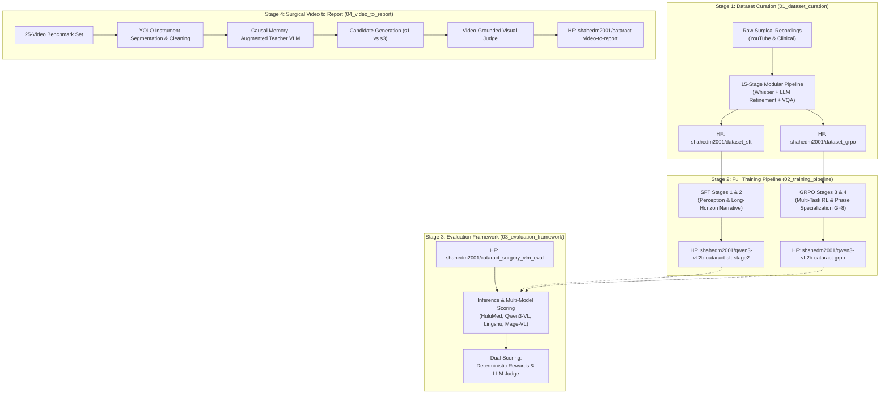

# Surgical-VLM: End-to-End Surgical Vision-Language Modeling for Cataract Surgery

[](LICENSE)
[](https://huggingface.co/datasets/shahedm2001/dataset_sft)
[](https://huggingface.co/datasets/shahedm2001/dataset_grpo)
[](https://huggingface.co/shahedm2001/qwen3-vl-2b-cataract-sft-stage2)
[](https://huggingface.co/shahedm2001/qwen3-vl-2b-cataract-grpo)
[](https://huggingface.co/datasets/shahedm2001/cataract_surgery_vlm_eval)
[](https://huggingface.co/datasets/shahedm2001/cataract-video-to-report)

This repository contains the complete, publication-ready codebase for our research paper on fine-grained surgical video understanding and automated operative reporting using Vision-Language Models (VLMs). 

The repository provides a single, unified monorepo organized into four sequential stages covering the entire research lifecycle: **Dataset Curation**, **4-Stage Progressive Training (SFT & GRPO)**, **Standardized Benchmarking Suite**, and **Clinical Operative Report Generation**.

---

## 🔗 Official Hugging Face Hub Assets

All curated datasets, model checkpoints, telemetry logs, and evaluation leaderboards are published on Hugging Face:

| Asset | Type | Hugging Face Repository | Description |
| :--- | :---: | :--- | :--- |
| **SFT Training Dataset** | Dataset | [`shahedm2001/dataset_sft`](https://huggingface.co/datasets/shahedm2001/dataset_sft) | 5,597 video clips + 108 unclipped full procedures covering visual QA, anatomy, and steps. |
| **GRPO Training Dataset** | Dataset | [`shahedm2001/dataset_grpo`](https://huggingface.co/datasets/shahedm2001/dataset_grpo) | 4,758 prompt slices for surgical MCQs, continuous temporal tasks, and phase recognition. |
| **SFT Stage 2 Checkpoint** | Model | [`shahedm2001/qwen3-vl-2b-cataract-sft-stage2`](https://huggingface.co/shahedm2001/qwen3-vl-2b-cataract-sft-stage2) | Long-horizon full-video narrative fine-tuned model (Rank 8 LoRA, stabilized gradients). |
| **Final GRPO Checkpoint** | Model | [`shahedm2001/qwen3-vl-2b-cataract-grpo`](https://huggingface.co/shahedm2001/qwen3-vl-2b-cataract-grpo) | Final standalone 16-bit deployment model with phase specialization ($G=8$). |
| **Evaluation Dataset** | Dataset | [`shahedm2001/cataract_surgery_vlm_eval`](https://huggingface.co/datasets/shahedm2001/cataract_surgery_vlm_eval) | 1,004 records + 518 videos for fine-grained clip and full-video benchmarking. |
| **Video-to-Report Leaderboard** | Dataset | [`shahedm2001/cataract-video-to-report`](https://huggingface.co/datasets/shahedm2001/cataract-video-to-report) | 25-video clinical benchmark outputs, comparisons, and interactive viewer. |

---

## 🧭 System Architecture

The project connects four cohesive methodological stages:



---

## 📁 Repository Layout

```text
Surgical-VLM/
├── README.md                      # Unified project landing page & publication overview
├── LICENSE                        # Apache 2.0 open-source license
├── .gitignore                     # Root-level ignore rules for media, caches, weights, and secrets
├── 01_dataset_curation/           # Stage 1: Raw video download, Whisper, LLM refinement, VQA synthesis
│   ├── README.md                  # Stage 1 detailed guide & step instructions
│   ├── config.yaml                # Pipeline configuration
│   ├── cli.py                     # Command-line orchestrator
│   ├── requirements.txt           # Stage 1 dependencies
│   ├── stages/                    # 15 core pipeline stages
│   ├── tools/                     # Phase dataset generators & verification tools
│   └── docs/                      # Exhaustive technical documentation & architecture charts
├── 02_training_pipeline/          # Stage 2: 4-stage SFT & GRPO reinforcement learning curriculum
│   ├── README.md                  # Stage 2 detailed curriculum guide & loss dynamics
│   ├── pyproject.toml             # Python build configuration
│   ├── environment.yaml           # Conda environment definition
│   ├── configs/                   # SFT & GRPO hyperparameter configs
│   ├── src/                       # Custom QwenGRPOTrainer, datasets, and reward models
│   ├── scripts/                   # Automated HF dataset downloaders & telemetry tools
│   ├── train_sft.sh               # SFT Stage 1 & Stage 2 runner
│   ├── grpo_train.sh              # GRPO Stage 3 foundation runner (G=4)
│   ├── grpo_stage4_phase.sh       # GRPO Stage 4 phase specialization runner (G=8)
│   └── ACADEMIC_REPORT.md         # Full loss graphs, Zero-Advantage analysis, and telemetry
├── 03_evaluation_framework/       # Stage 3: Multi-model evaluation across 1,004 records & 15 full procedures
│   ├── README.md                  # Stage 3 benchmark guide, schemas, & judge criteria
│   ├── main.py                    # Evaluation orchestrator (inference, judge, all)
│   ├── flatten_dataset.py         # Automated HF evaluation dataset unzipping & preparation
│   ├── dataset_loader.py          # Multimodal dataset ingestion
│   ├── llm_judge.py               # Deterministic metrics + LLM judge implementation
│   ├── fairness_experiment.py     # Judge consistency and stability evaluation suite
│   ├── *_inference.py             # Model inference runners (Qwen3-VL, HuluMed, Lingshu, Mage-VL)
│   └── results/                   # Complete score files, summaries, and comparison plots
└── 04_video_to_report/            # Stage 4: Clinical operative reporting pipeline & interactive dashboard
    ├── README.md                  # Stage 4 operative reporting guide & pipeline execution
    ├── pyproject.toml             # Dependencies locked via uv
    ├── run_pipeline.sh            # End-to-end pipeline launcher (YOLO -> Teacher -> Candidates)
    ├── src/vlm_report_framework/  # Segmentation, instrument cleaning, causal memory, & judging
    ├── docs/                      # Methods reports and 25-video subset selection criteria
    └── output-evaluation/v21full/ # Benchmark summaries, comparisons JSON, and dashboard
```

---

## 🚀 Execution Instructions by Stage

Each stage is completely self-contained. Below are quickstart instructions for each section. **Please prompt yourself to read each stage's dedicated README for exhaustive technical details, parameters, and troubleshooting.**

### Stage 1: Dataset Curation (`01_dataset_curation`)

Build training datasets from raw video links:

```bash
cd 01_dataset_curation
pip install -r requirements.txt
cp .env.example .env          # Set REFINER_API_KEY, GEMINI_API_KEY, etc.

# Run complete 15-step dataset curation pipeline:
python cli.py

# Or run individual steps:
python cli.py --step download
python cli.py --step transcribe
python cli.py --step vlm
```

> [!TIP]
> **Detailed Documentation:** For complete explanations of all 15 pipeline stages, phase-level teacher/critic SFT generation, and configuration schemas, please read [`01_dataset_curation/README.md`](01_dataset_curation/README.md).

---

### Stage 2: Full Training Pipeline (`02_training_pipeline`)

Train the Qwen3-VL-2B model through the 4-stage progressive curriculum:

```bash
cd 02_training_pipeline
pip install -r requirements.txt
cp .env.example .env          # Set HF_TOKEN if needed

# 1. Stage 1 SFT: Full perception & VQA (5,597 video clips)
bash train_sft.sh

# 2. Stage 2 SFT: Long-horizon full video coherence (108 full videos + 10% clips)
STAGE2_EPOCHS=1 CLIP_FRACTION=0.1 FULL_FRACTION=1.0 \
  MODEL_ID=shahedm2001/qwen3-vl-2b-cataract-sft \
  BATCH_PER_DEVICE=4 GRAD_ACCUM=4 NFRAMES=64 bash train_sft.sh

# 3. Stage 3 GRPO: Multi-task foundation RL (G=4 rollouts)
GRPO_MICRO_PROMPTS=1 BATCH_PER_DEVICE=1 GRAD_ACCUM=8 bash grpo_train.sh

# 4. Stage 4 GRPO: Phase specialization & anti-forgetting replay (G=8 rollouts)
bash run_stage4_pipeline.sh
```

*Note: Training scripts automatically fetch dataset archives from Hugging Face via `scripts/ensure_dataset_sft.sh` and `scripts/ensure_dataset_grpo.sh` if not present locally.*

> [!TIP]
> **Detailed Documentation:** For the theoretical analysis of the Zero-Advantage Bottleneck, training dynamics curves, and LoRA fusion procedures, please read [`02_training_pipeline/README.md`](02_training_pipeline/README.md).

---

### Stage 3: Evaluation Framework (`03_evaluation_framework`)

Benchmark VLMs across 989 clip-level and 15 full-video surgical tasks:

```bash
cd 03_evaluation_framework
pip install -r requirements.txt
cp .env.example .env          # Set HF_TOKEN and PROVIDER_API_KEY

# 1. Download and unpack the evaluation benchmark from Hugging Face:
python flatten_dataset.py \
    --hf-repo shahedm2001/cataract_surgery_vlm_eval \
    --output-dir ./evaluation_dataset

# 2. Run inference with Qwen3-VL-2B:
python main.py \
    --mode inference \
    --model-family qwen3vl \
    --model-id shahedm2001/qwen3-vl-2b-cataract-grpo \
    --dataset-root ./evaluation_dataset \
    --output-dir ./results

# 3. Grade model outputs with the LLM Judge:
python main.py \
    --mode judge \
    --model-family qwen3vl \
    --model-id shahedm2001/qwen3-vl-2b-cataract-grpo \
    --output-dir ./results
```

> [!TIP]
> **Detailed Documentation:** For complete benchmark question types (MCQs, boundary detection, tIoU, visual description, procedural narration), fairness evaluation protocols, and precomputed model results, please read [`03_evaluation_framework/README.md`](03_evaluation_framework/README.md).

---

### Stage 4: Surgical Video to Report Framework (`04_video_to_report`)

Generate structured clinical operative reports from full surgery recordings:

```bash
cd 04_video_to_report
uv sync
cp .env.example .env          # Configure teacher and judge endpoints

# Run full report generation pipeline:
bash run_pipeline.sh

# Run post-hoc video-grounded visual judging:
uv run python src/vlm_report_framework/evaluation/batch.py \
    --videos all --tags qwen3vl-2b-grpo --run-id v21full --workers 8

# Compile standalone full-video operative reports:
uv run python src/vlm_report_framework/evaluation/compile_self.py \
    --tag qwen3vl-2b-grpo --setting s3 --videos all

# Generate interactive HTML dashboard:
uv run python src/vlm_report_framework/evaluation/viewer.py --run-id v21full
```

> [!TIP]
> **Detailed Documentation:** For YOLO segmentation details, 3-tier instrument noise cleaning, causal memory snapshot designs, and 25-video benchmark analysis, please read [`04_video_to_report/README.md`](04_video_to_report/README.md).

---

## 💻 Hardware & System Requirements

- **GPU**: NVIDIA GPU with ≥ 24 GB VRAM (e.g., RTX 3090, RTX 4090, A5000, A100, H100).
- **CUDA**: CUDA ≥ 12.1 (CUDA 13.0 recommended for PyTorch 2.5+).
- **RAM**: ≥ 32 GB system memory recommended.
- **Disk**: ≥ 60 GB SSD storage if downloading full video archives for training or evaluation.
- **Package Managers**: `pip`, `conda`, and [`uv`](https://docs.astral.sh/uv/) (for fast dependency management).

---

## 📜 Citation

If you use this codebase, models, or datasets in your research, please cite our paper:

```bibtex
@article{momenzadeh2026surgicalvlm,
  title={Fine-Grained Surgical Video Understanding and Automated Operative Reporting via Multi-Stage Vision-Language Models},
  author={Momenzadeh, Shahed and Contributors},
  journal={arXiv preprint},
  year={2026}
}
```

---

## 📄 License

This project is licensed under the [Apache 2.0 License](LICENSE).
